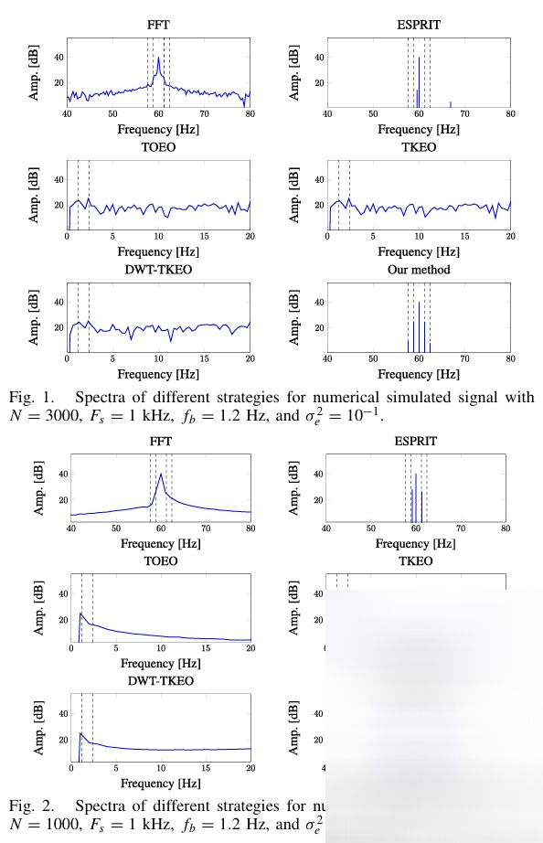
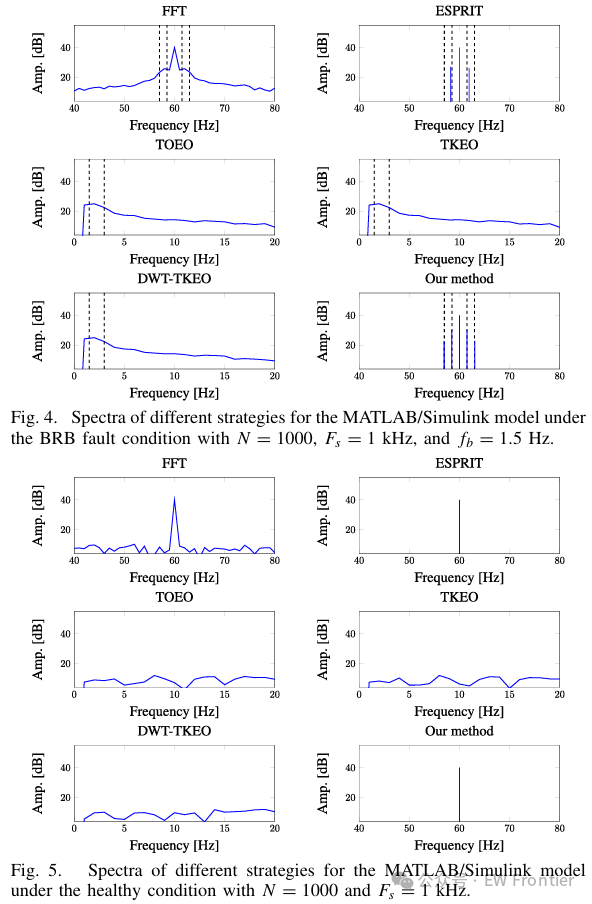
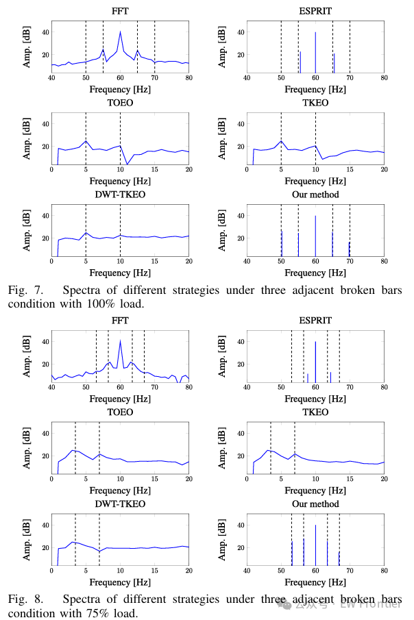
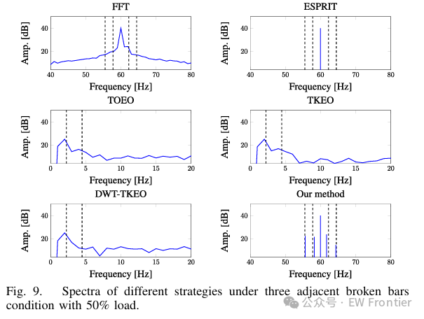
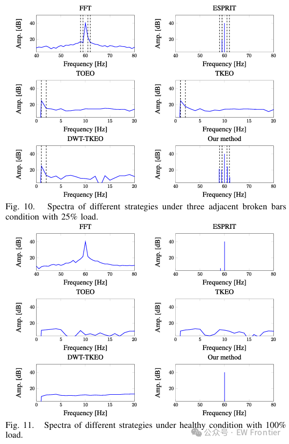

# [Fault Diagnosis] Sparse Bayesian Learning Method for Break Rotor Bar Fault Diagnosis [Attached MATLAB Code]

This paper discusses the issue of rotor bar break (BRB) fault detection in induction motors (IM). The widely used Fast Fourier Transform (FFT) method is sensitive to noise and has a low resolution for short-term data, while subspace-based methods suffer from significant performance degradation due to improper model order selection and spatial smoothing. To effectively identify weak fault sidebands from rotor current signals, we convert the fault sideband identification problem into a sparse representation (SR) problem and propose a novel Sparse Bayesian Learning (SBL) method for BRB fault diagnosis. The novelty of our proposed method is threefold: 1) Combining a three-stage hierarchical sparse prior into the SBL framework to significantly enhance the sparsity of the current spectrum, resulting in sharp fracture sidebands; 2) Introducing a new efficient computational SR model with a truncation spectral grid to significantly reduce the computational load of Bayesian inference; 3) Using the symmetric pairing structure of the fault sideband as prior knowledge to improve the robustness of BRB identification performance. Simulation and experimental results demonstrate the superiority of the proposed method, particularly for current signals with short sampling times or high noise levels.
Introduction
Induction motors (IM) are widely used in industrial applications due to their reliability, efficiency, cost-effectiveness, and ease of maintenance [1]. Extreme working conditions (e.g., overload and unforeseen events) can lead to IM failures. Many studies have shown that rotor bar break (BRB) faults account for 10%-20% of all IM faults [2]. When BRB faults occur early, IM usually operates without any deteriorating signs [3], [4]. Therefore, early BRB faults can lead to other damages, affecting device performance and potentially causing economic losses and/or serious safety incidents [5]. The fundamental requirement is to accurately and timely identify BRB faults.
Over the past few decades, a vast array of BRB fault diagnosis techniques has been developed through the use of various fault characteristics. These include motor current features [6], [7], [8], [9], vibration signals [10], air-gap magnetic fields [11], torque waveforms [12], thermal imaging [13], and sound signals [14]. Among these, Current Signature Analysis (MCSA) is one of the most popular and powerful methods for BRB fault diagnosis due to its simplicity, remote diagnostic capabilities, non-invasiveness, and low implementation costs. It is well known that BRB faults generate amplitude modulation in stator currents, which results in a fault sideband around the power frequency. Traditionally, MCSA relies on Fast Fourier Transform (FFT) to obtain the spectrum and then identify the fault sideband for diagnosing BRB faults. However, FFT-based methods are sensitive to noise and often overlap nearby spectral components into a broader spectrum component due to inherent low resolution issues. Although these drawbacks can be mitigated by measuring the current signal over a longer time series, they introduce load fluctuations in practical implementations.
Various advanced signal processing techniques have been proposed to assist in fault diagnosis based on FFT for BRBs. For example, [18] introduced a multi-rate signal processing technique to eliminate spectral leakage of the power frequency but completely ignored the spectral leakage of the fault sideband. Bellini et al. [7] used dense grids to cover a certain frequency range and attempted to detect the target frequency by searching for the maximum cross-correlation. Such dense grids can address the low resolution issue of FFT, but they are still sensitive to noise and/or masking effects of the power frequency. Gyftakis et al. [19] suggested using the sum of all phase currents instead of single-phase currents to detect BRB faults. This summation operation can improve the Signal-to-Noise Ratio (SNR), but all limitations caused by FFT remain unresolved. Moreover, there are many decoding-based methods [8], [16], [20] in the literature aimed at combating spectral leakage of the power frequency by eliminating power component elements. However, they still suffer from inherent low resolution issues caused by FFT and may not work effectively, especially for short-term data.
On the other hand, several subspace type methods have been proposed to directly estimate the fault sideband, such as Multi-Signal Classification (MUSIC) [21] and Estimating Signal Parameters via Rotation Invariant Techniques (ESPRIT) [22] [23]. These methods exploit the orthogonality between the signal and noise subspaces, achieving high-resolution frequency estimation. The outstanding performance of frequency estimation by subspace type methods largely depends on perfect knowledge of the model order. However, it is often difficult to obtain knowledge of the model order in practice. If previous model order estimates are inaccurate, it can lead to significant performance degradation [22]. Another disadvantage of subspace type methods is that the spatial smoothing technique required to calculate the autocorrelation matrix of the target signal [24] can cause severe error accumulation problems, especially for low SNR.
Recently, the emerging technique of Sparse Representation (SR) has rekindled interest in fault diagnosis [25], [26], [27]. Compared to subspace-type methods, SR-based approaches exhibit many advantages such as improved robustness, limited snapshots, and learning capabilities [28]. Sparse Bayesian Learning (SBL) is one of the most popular SR methods, using a probability Bayesian framework to solve the sparse recovery problem. Note that SBL includes the standard L1-norm minimization as a special case of the Laplace prior. Due to the flexible prior provided by SBL, which can learn unknown hyperparameters automatically, it is expected to achieve enhanced performance. Dai and Soo [28] analyzed vibration signals for bearing fault diagnosis within the SBL framework and designed two cluster sparse learning methods. Experimental results show that the SBL method can achieve better fault detection performance than the standard L1-norm minimization method. However, applying SBL directly to BRB fault diagnosis of stator current signals presents challenges due to: 1) The commonly used sparse prior in the SBL framework does not well fit with the stator current signal because the amplitude of the fault sideband is weak compared to the power frequency amplitude, and 2) Covering the entire frequency domain with a dense grid is computationally difficult due to the large size of the stator current signal.
To address these challenges, in this paper, we attempt to propose a novel BRB fault diagnosis method based on SBL, whose contributions are summarized as follows.
A three-stage hierarchical sparse prior is proposed for BRB fault diagnosis, which significantly enhances the sparsity of the target signal, which in turn helps identify the fault sideband from the stator current spectrum.
A new truncation disconnected model is introduced into the SBL framework to significantly reduce the computational complexity of Bayesian inference.
The additional symmetric paired sparse structure of the fault sideband is utilized to greatly improve the BRB fault recognition performance.
Please note that the following two contributions are highly dependent on the restricted and symmetric characteristics of fault sidebands, which will be discussed in detail in Section III-A. Both simulation results and experimental outcomes have validated the superiority of the proposed method, particularly for short-term sampling data.
Article illustrations
Conclusion
This paper discusses the problem of identifying fault sidebands from stator current signals for BRB fault diagnosis. The state-of-the-art methods often perform poorly under conditions of short sampling time and/or high noise level. To improve the performance of BRB fault diagnosis, we convert the identification task into an SBL problem and then propose a new SBL framework to recover sparse signals. The new method utilizes a three-stage hierarchical sparse before to strictly strengthen the sparsity of the stator current spectrum, and combines the symmetric pairing sparse structure into this prior to meet the symmetry properties of the recovered spectrum, thereby significantly improving the performance of fault sideband identification. Moreover, we utilize a new truncation off-grid model to cover a smaller frequency range instead of the entire frequency domain, thus significantly reducing the computational complexity of SBL. Both simulations and experiments have verified the superiority of the proposed method, particularly for short measurements and/or high noise levels. Although the proposed method shows potential applications in various IMs, its applicability to small single-phase IMs remains undecided. Looking forward to future work that can bring some positive results in this area would be interesting.
End

## Images

<!-- PAYMENT_BLOCK -->

## Get this dataset

- Payment link (Stripe): [Buy now](https://buy.stripe.com/3cs8yP7sY87d0vu9AB)
- Payment QR code: 

<!-- /PAYMENT_BLOCK -->
